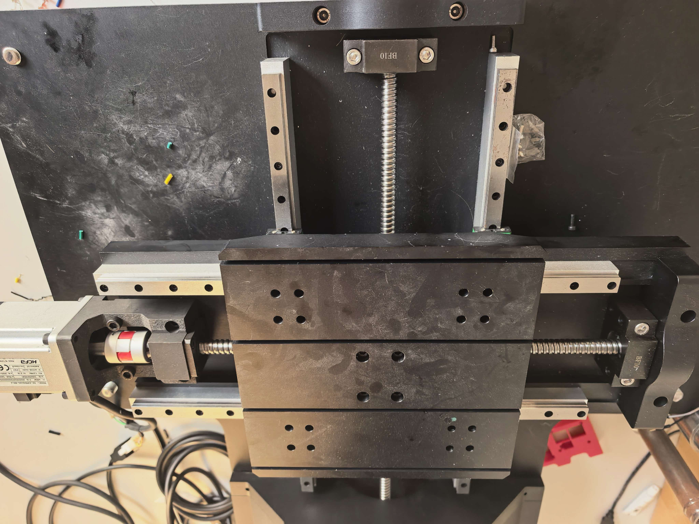
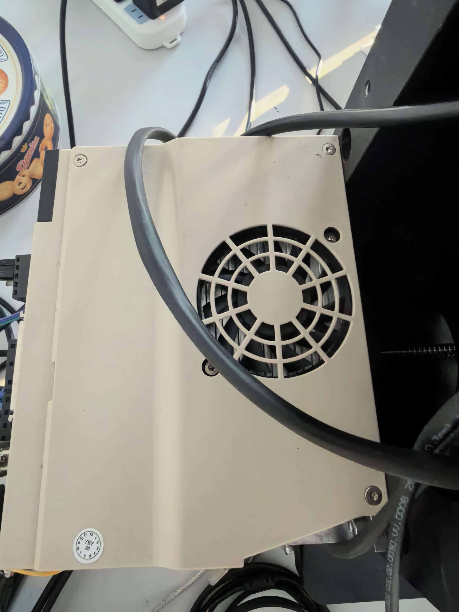

# 源泰高精度位移平台

## 产品概述

源泰高精度位移平台采用伺服电机驱动，配套专用伺服驱动器和上位机控制软件，行程 50 mm / 100 mm 可选，重复定位精度 ≤1 µm，定位分辨率 0.1 µm，支持单轴、双轴、三轴配置，适用于精密测量、光学检测、自动化定位等场合。

**系统位移精度5微米**

**系统重复定位精度5微米**

## 系统组成

| 部件 | 说明 |
|---|---|
| 位移平台 | 单轴 / 双轴 / 三轴，行程 50 mm 或 100 mm |
| 伺服电机 | 源泰配套伺服电机，17 bit 绝对值编码器 |
| 伺服驱动器 | 源泰配套驱动器，位置控制，RS485 通信 |
| 上位机软件 | 参数配置、点位运动、状态监控、故障报警 |
| 配套线缆 | 电机动力线、编码器线、通信线 |

## 主要参数

| 项目 | 参数 |
|---|---|
| 行程 | 50 mm / 100 mm（可选） |
| 重复定位精度 | ≤1 µm |
| 定位分辨率 | 0.1 µm |
| 编码器 | 17 bit 绝对值，131072 计数/转 |
| 额定转速 | 3000 rpm |
| 最大速度 | 200 mm/s |
| 控制方式 | 位置控制 |
| 位置指令 | 内部多段位置，最多 16 段 |
| 通信接口 | RS485，Modbus RTU |
| 通信速率 | 最高 115200 bps |
| 供电 | AC 220 V |
| 使用环境 | 0~40 °C，20~85% RH（无结露） |
| 电机防护 | IP65 |

## 功能特点

- 微米级定位：重复定位精度 ≤1 µm，定位分辨率 0.1 µm。
- 高分辨率编码器：17 bit 绝对值编码器，单圈 131072 计数。
- 多段位置控制：16 段位置、速度、加减速独立设置，支持顺序执行和随机执行。
- 绝对位置保持：配电池后可实现多圈绝对位置，断电位置不丢失。
- 平滑启停：位置指令滤波、加减速时间可调，运动平稳。
- 振动抑制：内置陷波滤波和自适应滤波，抑制停止后的残余振动。
- 状态监控：实时读取位置、速度、转矩、电流等运行状态。
- 多轴组网：RS485 总线，支持 X / Y / Z 三轴组网控制。
- 故障保护：过流、过载、过速、位置偏差过大等报警保护。

## 上位机软件

源泰配套上位机运行于 Windows 系统，通过 RS485 与驱动器通信，主要功能：

- 三轴位置控制与点位运动；
- 速度、加减速、位移参数设置；
- 当前位置、速度、转矩状态显示；
- 手动上升 / 下降 / 左移 / 右移操作；
- 多段位置参数配置与保存；
- 故障报警提示与通信状态监视。

## 应用领域

精密测量、光学检测、半导体设备、自动化装配、科研实验等。

## 配置说明

平台支持单轴、双轴、三轴配置，行程可选 50 mm 或 100 mm。伺服电机、驱动器、上位机软件由源泰配套提供，开箱即可联机使用。

## 附件图片

